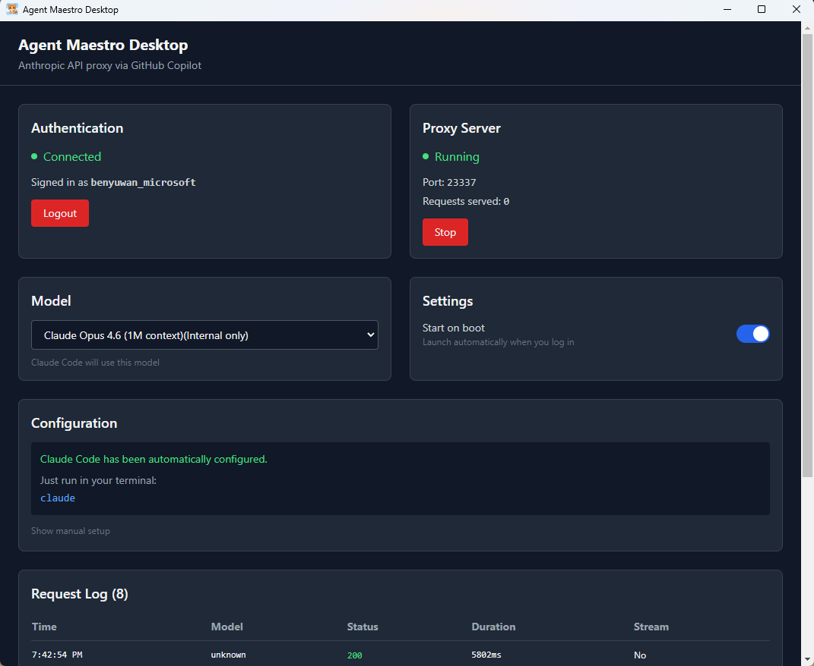

# Agent Maestro Desktop



## Overview

Agent Maestro Desktop is an open-source local desktop application inspired by [agent-maestro](https://github.com/Joouis/agent-maestro).
It proxies Anthropic API requests and allows you to access Claude Code using a GitHub Copilot token.

Key features:
- Local Claude API proxy with Copilot token authentication
- Claude prompt caching via Copilot's Anthropic Messages API
- Auto-configures proxy settings for Claude Code, VSCode extension, and local CLI
- Multi-model auto-detection and selection (automatically picks the best model after login)
- Intuitive UI with request logs, model switching, and settings panel
- VS Code Codespace auto-bridge: detects locally-open codespaces and tunnels them through the proxy automatically

> **Platform support:** Windows 10+ and macOS 11+ (Apple Silicon and Intel). Linux is not supported.

## Installation

Download a build from [Releases](https://github.com/StudentWan/agent-maestro-desktop/releases):

- **Windows:** run `AgentMaestroDesktop-<version>.exe`.
- **macOS:** download `AgentMaestroDesktop-<version>-macOS-arm64.zip` for Apple Silicon, or `macOS-x64.zip` for Intel. Extract it and move **Agent Maestro Desktop.app** to **Applications** before opening it or enabling launch at login.

macOS builds are not Developer ID signed or notarized. If macOS blocks the first launch, use **System Settings → Privacy & Security → Open Anyway** for the downloaded app after checking its source.

### Build from source

Requires Node.js 22 and npm on Windows or macOS. Build on the operating system you intend to use.

### Clone the repository
```bash
git clone https://github.com/StudentWan/agent-maestro-desktop.git
cd agent-maestro-desktop
```

### Install dependencies
```bash
npm ci
```

### Start development server
```bash
npm run dev
```

### Build production installer
```bash
npm run make
```

The Windows installer or macOS ZIP will be generated in `out/make`. macOS builds use the host architecture by default; use `npm run make -- --arch=arm64` or `npm run make -- --arch=x64` to choose an architecture.

### Codespaces on macOS

Install GitHub CLI (`brew install gh`) to use Codespaces. The app searches the standard Apple Silicon and Intel Homebrew paths when launched from Finder. For a custom `gh` installation, launch the app from a terminal whose `PATH` includes it.

Automatic detection of open VS Code Codespaces uses macOS System Events. Allow the requested **Automation** and **Accessibility** access in **System Settings → Privacy & Security** for the app (or Terminal/Electron when running from source). The detector reads window titles from VS Code, VS Code Insiders, and Code - OSS. Manual connections from the Codespaces panel work without these permissions.

Closing the window keeps the proxy running in the menu bar. Click the Dock icon or choose **Show** in the menu bar to reopen it; use **Quit** or **⌘Q** to exit.

## Configuration & Usage

1. Launch the app, click Login, and enter your GitHub Copilot credentials (requires an active Copilot subscription)
2. After login, the app automatically configures Claude Code and VSCode extension to use the local proxy
3. Use the sidebar UI to switch models, view request logs, and modify settings
4. The proxy port defaults to 23337 and can be customized in the settings page

## FAQ

- **Login failed?** Make sure you have an active Copilot subscription and your token has not expired
- **Claude Code / VSCode not connecting?** Check your `~/.claude/settings.json` — the proxy port and token must match
- **Icons not showing?** Clear your Windows icon cache and ensure icon.ico is generated with electron-icon-builder
- **Installer or startup issues?** Re-run `npm run make`. On macOS, check that the archive matches your Mac's architecture and that the app is in Applications.

## Contributing

Contributions are welcome! Here's how:
1. Fork this repository
2. Create a new branch: `git checkout -b feat/my-feature`
3. Commit your code with unit tests
4. Open a PR describing your changes and their impact
5. Wait for community/maintainer review and CI to pass

### Code Standards
- TypeScript + React + Electron — use Prettier and ESLint for auto-formatting
- New features should include tests (Vitest/Jest)
- Icons and assets should use CC0 or original artwork to avoid copyright issues

## License

MIT License

## Screenshots


> To add more UI/feature screenshots, place them in `assets/screenshots/` and reference them with Markdown

---

**This project is actively maintained. Feel free to open issues, submit PRs, or join the community!**
